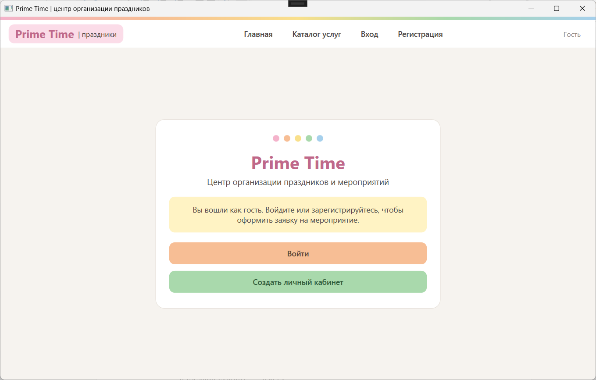
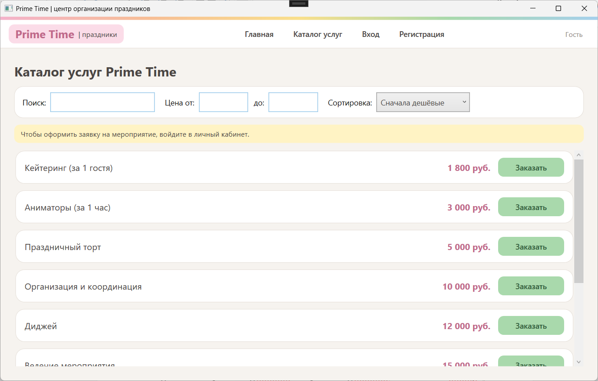
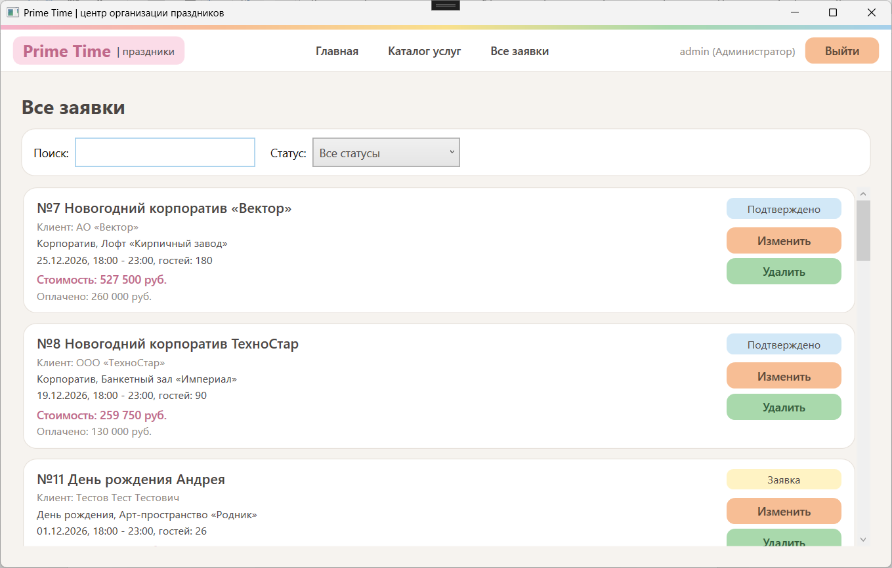

# Prime Time: информационная система центра организации праздников

Prime Time – настольное WPF-приложение для центра организации праздников и мероприятий (свадьбы, корпоративы, дни рождения, выпускные, конференции, детские праздники). Приложение работает с базой данных MS SQL Server и позволяет просматривать каталог услуг, регистрироваться, оформлять заявки на мероприятия и управлять ими в зависимости от роли пользователя. Проект выполнен в рамках лабораторной работы № 4 по дисциплине «Технология разработки программного обеспечения» на основе базы данных из лабораторной работы № 3.

## Визуальная демонстрация

Скриншоты хранятся в папке `docs/screenshots/`.

| Страница | Файл |
|---|---|
| Главная | `docs/screenshots/home.png` |
| Вход | `docs/screenshots/login.png` |
| Регистрация | `docs/screenshots/register.png` |
| Каталог услуг | `docs/screenshots/catalog.png` |
| Оформление заявки | `docs/screenshots/order.png` |
| Список заявок | `docs/screenshots/orders.png` |
| Редактирование заявки | `docs/screenshots/edit-order.png` |







## Технологии

- Язык: C#
- Платформа: .NET Framework 4.7.2
- Интерфейс: WPF (одно окно `MainWindow` с `Frame`, все экраны сделаны как `Page`)
- База данных: Microsoft SQL Server (Express)
- Доступ к данным: ADO.NET (`SqlConnection`, `SqlCommand`, параметризованные запросы, транзакции)
- Среда разработки: Visual Studio 2019 или новее

## Установка

Требования: Windows 10 или новее, Visual Studio с компонентом «Разработка классических приложений .NET», SQL Server Express и SQL Server Management Studio.

1. Клонируйте репозиторий:
```bash
git clone https://github.com/your-username/PrimeTime.git
cd PrimeTime
```

2. Создайте базу данных. В SQL Server Management Studio выполните скрипты из лабораторной работы № 3: создание базы `PrimeTime`, 14 таблиц и тестовых данных. Затем создайте таблицы ролей и пользователей и добавьте тестовые учётные записи:
```sql
CREATE TABLE Roles (
role_id INT IDENTITY(1,1) NOT NULL PRIMARY KEY,
name NVARCHAR(30) NOT NULL UNIQUE
);
CREATE TABLE Users (
user_id INT IDENTITY(1,1) NOT NULL PRIMARY KEY,
role_id INT NOT NULL REFERENCES Roles (role_id),
client_id INT NULL REFERENCES Clients (client_id),
login NVARCHAR(50) NOT NULL UNIQUE,
password_hash NVARCHAR(64) NOT NULL
);
CREATE UNIQUE INDEX UX_Users_client ON Users (client_id) WHERE client_id IS NOT NULL;
INSERT INTO Roles (name) VALUES (N'Администратор'), (N'Менеджер'), (N'Клиент');
INSERT INTO Users (role_id, client_id, login, password_hash) VALUES
(1, NULL, N'admin', N'3b612c75a7b5048a435fb6ec81e52ff92d6d795a8b5a9c17070f6a63c97a53b2'),
(2, NULL, N'manager', N'61b3ad24336c20515573dc7d875cb9295e8462cec645c3604ac58f1e241e20e0');
```
Клиентские учётные записи создаются через форму регистрации в приложении.

3. Укажите строку подключения в классе `DbConnector` (файл `PrimeTime/App.xaml.cs`):
```csharp
public static string ConnectionString = @"Server=.\SQLEXPRESS01;Database=PrimeTime;Trusted_Connection=True;Connect Timeout=5;";
```
Замените `.\SQLEXPRESS01` на имя вашего экземпляра SQL Server.

4. Откройте решение `PrimeTime.sln` в Visual Studio, дождитесь восстановления зависимостей и запустите проект клавишей F5.

## Использование

Сначала откроется главная страница. Навигация выполняется через верхнее меню, набор кнопок зависит от роли.

Тестовые учётные записи:

| Логин | Пароль | Роль |
|---|---|---|
| admin | Admin123 | Администратор |
| manager | Manager123 | Менеджер |

Регистрация и вход:
1. Нажмите «Регистрация», заполните поля формы (поля со звездочкой обязательны) и нажмите кнопку создания личного кабинета.
2. Нажмите «Вход», введите логин и пароль.

Оформление заявки (роль «Клиент»):
1. Откройте «Каталог услуг», при необходимости воспользуйтесь поиском, фильтром по цене и сортировкой.
2. Выберите услугу для заявки или нажмите «Оформить заявку» в меню.
3. Укажите название, тип мероприятия, площадку, дату, время начала и окончания (формат `чч:мм`), число гостей и услуги с количеством.
4. Нажмите «Рассчитать» для предварительной стоимости, затем сохраните заявку и подтвердите оформление. После этого откроется список заявок.

Управление заявками:
1. Откройте «Мои заявки» (клиент) или «Все заявки» (менеджер и администратор).
2. Отфильтруйте список по статусу или найдите заявку по названию или имени клиента.
3. Нажмите «Изменить», чтобы открыть страницу редактирования. Статус заявки меняют только менеджер и администратор.
4. Нажмите «Удалить» и подтвердите действие. Клиент удаляет только свои заявки со статусом «Заявка», администратор любые.

Пример результата при ошибке ввода:
```
Предупреждение
Выбранная площадка вмещает не более 100 гостей!
```

### Роли и права доступа

| Роль | Возможности |
|---|---|
| Гость | Просмотр главной страницы и каталога услуг, вход и регистрация |
| Клиент | Все возможности гостя, оформление заявки, просмотр своих заявок, изменение и удаление своих заявок со статусом «Заявка» |
| Менеджер | Просмотр всех заявок, изменение данных заявки и её статуса |
| Администратор | Все возможности менеджера, удаление любых заявок |

Заказом считается заявка на мероприятие: запись в таблице `Events` и выбранные услуги в таблице `EventServices`. При удалении заявки в одной транзакции удаляются связанные строки `Payments`, `Reviews`, `EventStaff`, `EventEquipment` и `EventServices`, а затем сама заявка, так как каскадное удаление в базе не используется. Права проверяются и в интерфейсе, и в SQL-запросах (владелец и статус заявки).

### Валидация и обработка ошибок

- Обязательные поля, формат ФИО (только буквы), телефон (не менее 10 цифр), адрес электронной почты, логин (не менее 3 символов: латиница, цифры, точка, подчёркивание), пароль (не менее 6 символов) и совпадение паролей проверяются при регистрации
- Дата мероприятия не может быть в прошлом (для клиента), время окончания должно быть позже времени начала, число гостей не должно превышать вместимость площадки
- Перед сохранением и изменением заявки проверяется, свободна ли площадка в выбранное время
- Количество каждой выбранной услуги должно быть целым числом больше нуля
- Удаление заявки требует подтверждения
- Все обращения к базе данных обёрнуты в `try/catch`, сообщения об ошибках показываются через `MessageBox`, необработанные исключения перехватываются общим обработчиком
- Пароли хранятся в базе в виде хеша SHA-256 (hex-строка), SQL-запросы выполняются с параметрами

## Статус реализации

Реализовано:
- главное окно с `Frame` и верхним меню, зависящим от роли
- страницы `HomePage`, `LoginPage`, `RegisterPage`
- страница `CatalogPage`: просмотр услуг, поиск, фильтр по цене, сортировка
- страница `OrderPage`: оформление заявки с проверкой ввода
- страница `OrdersPage`: список заявок, фильтр по статусу, поиск, изменение и удаление по ролям
- страница `EditOrderPage`: редактирование заявки и её услуг, смена статуса для сотрудников
- разграничение прав для гостя, клиента, менеджера и администратора

## Структура проекта

```
PrimeTime/
├── .gitignore
├── PrimeTime.sln
├── README.md
├── docs/
│   └── screenshots/
└── PrimeTime/
    ├── App.xaml
    ├── App.xaml.cs
    ├── App.config
    ├── MainWindow.xaml
    ├── MainWindow.xaml.cs
    ├── PrimeTime.csproj
    ├── Properties/
    ├── Entity/
    └── Pages/
        ├── HomePage.xaml
        ├── LoginPage.xaml
        ├── RegisterPage.xaml
        ├── CatalogPage.xaml
        ├── OrderPage.xaml
        ├── OrdersPage.xaml
        └── EditOrderPage.xaml
```

- `App.xaml.cs`: классы `Session` (текущий пользователь и его роль) и `DbConnector` (строка подключения, SHA-256, проверки ввода, вывод сообщений), общий обработчик исключений
- `MainWindow.xaml(.cs)`: главное окно, `Frame` для страниц, верхнее меню с кнопками по ролям
- `Pages/`: страницы приложения, переходы выполняются через `NavigationService.Navigate(new ...Page())`
- `Entity/`: папка для классов сущностей
- `Properties/`: служебные файлы проекта
- `App.config`: настройки запуска для .NET Framework 4.7.2

## Данные

Используется база данных `PrimeTime` в MS SQL Server, спроектированная в лабораторной работе № 3 и приведённая к третьей нормальной форме. База содержит 14 таблиц: `Clients`, `Positions`, `Staff`, `EventTypes`, `Venues`, `Events`, `Equipment`, `EventEquipment`, `Services`, `EventServices`, `EventStaff`, `PaymentMethods`, `Payments`, `Reviews`. Для приложения добавлены таблицы `Roles` и `Users`.

Основные связи:
- `Clients` – `Events`: один клиент, много мероприятий
- `EventTypes` – `Events` и `Venues` – `Events`: тип и площадка мероприятия
- `Events` – `Services`, `Equipment`, `Staff`: связь «многие ко многим» через `EventServices`, `EventEquipment`, `EventStaff`
- `Events` – `Payments`: одно мероприятие, несколько платежей
- `Events` – `Reviews`: один к одному
- `Roles` – `Users` и `Clients` – `Users`: роль и клиент пользователя

Статусы заявки: «Заявка», «Подтверждено», «Проведено», «Отменено».